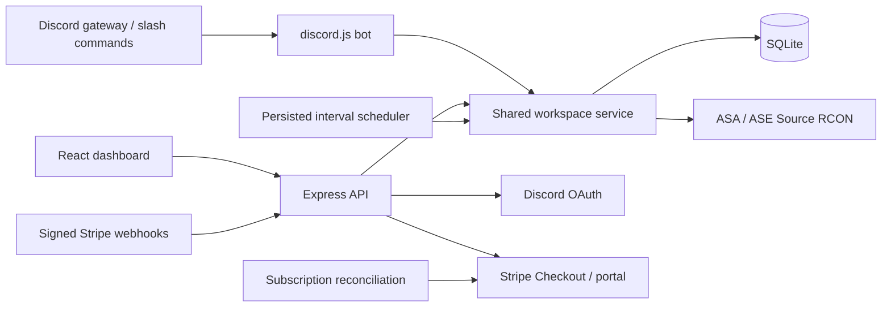

# Rookrift architecture

`server/index.js` owns process lifecycle, gateway startup, monitoring, the scheduler, and periodic billing reconciliation. `server/app.js` handles OAuth, sessions, CSRF, schemas, REST routes, and static production assets. `server/service.js` is shared by browser actions, bot commands, and scheduled tasks, so limits cannot be bypassed by switching interfaces.

Each Discord identity owns one workspace. Every server, schedule, activity record, and Stripe subscription belongs to that workspace. A guild may be linked to one workspace only. Dashboard access is owner-only. Discord community members with Manage Server can execute commands against the linked workspace, so linking a guild intentionally grants those admins operational control.

There is no client-selected workspace ID on mutations. The session resolves the owner workspace server-side. Server deletion and controls resolve the target within that workspace. Paid access is derived from current subscription status and known configured prices. Unknown prices and non-active payment statuses resolve to the free plan.

RCON and Discord access tokens are encrypted with AES-256-GCM and random IVs. Browser sessions use random 256-bit opaque tokens whose hashes are stored in SQLite. Production cookies use Secure, HttpOnly, and SameSite=Lax. OAuth state is hashed, short-lived, bound to a browser cookie, and consumed once. Mutating authenticated requests require an exact Origin and CSRF header. No encryption key is shipped to the browser.

Public target validation rejects loopback, link-local, private, multicast, and reserved IP ranges unless an operator opts into private connectivity. DNS results are validated and pinned. In production, enforce network egress rules in addition to application validation. A compromised host must not have unrestricted access to internal infrastructure.

The DayZ adapter declares its different BattlEye protocol and remains unavailable. Adding a game requires a transport implementation, command mapping, parser tests, connection tests, and UI capability updates. Never route DayZ through the ARK Source RCON adapter.

The hosted Site packages `dist/` from `npm run build:demo`. It intentionally uses browser storage and simulated actions. The Docker deployment runs a live-mode build, real OAuth, the persistent backend, Discord gateway, Stripe endpoints, and TCP RCON. They are separate deployment targets.

Schema upgrades add groups, maintenance state, the current player snapshot, workspace alert preferences, and the latest task outcome to existing installations. Additions are idempotent and transactional. Take a consistent database/key backup before upgrades. Private credentials remain encrypted; `publicServer` strips both the secret and the internal JSON player cache. The authenticated bootstrap emits a separate filtered player roster for online, entitled servers.

Bulk commands validate the complete selection before side effects and then use bounded batches of four connections. Each individual operation still passes through the shared tenant/entitlement checks and per-server lock. Responses preserve per-server failures. There is no transactional rollback for game commands, and a lost HTTP response is not proof that a command was not executed.

Maintenance is an operational preference, not a game-process state. Scheduler attempts are skipped and recorded while monitoring continues. Workspace and per-server alert preferences suppress outgoing connection notifications without suppressing audit events. Task run-now and scheduled execution share the same outcome writer and per-task lock. Manual runs preserve the next scheduled timestamp.

CSV generation is shared and tested independently. It exports only visible activity records, escapes quoted cells, and neutralizes formula prefixes rather than exposing an executable spreadsheet payload. Browser components for fleet tools and common controls live in `src/features.jsx` and `src/ui.jsx`.

Scaling boundaries: one process, one SQLite store, sequential poll cycles, local command locks. Use PostgreSQL plus a queue and distributed job claims before multiple replicas. A production operation also needs monitoring, external uptime checks, restore drills, incident response, account deletion/export handling, and dependency maintenance.

`server/operations.js` provides owner-scoped announcement templates, windows, metrics, incidents, notifications, moderation, execution-history reads, and hosting links. `server/operations-state.js` shares monitoring/maintenance behavior with the scheduler; pure wall-clock and template helpers live under `shared/operations.js`. Outage counters open one incident after the configured consecutive-failure threshold and reset during maintenance/recovery. Notifications are persistent records, separate from Discord delivery.

`server/hosting.js` implements a bounded HTTPS Pterodactyl adapter. It pins a validated address while preserving normal TLS/hostname verification, never follows redirects, bounds response size/time, and whitelists returned provider fields. Keys are encrypted on storage and decrypted only for server-side requests. Power/backup mutations require exact server-name confirmation and a per-server lock; the API records acceptance rather than inventing completion. The Docker runtime includes the shared helpers.

Moderation accepts one safe identifier argument, checks the target against the latest server snapshot for kick/ban, and records internal reasons separately from the RCON command. Unban requires a tracked ban. Broadcasts strip ARK's command-separator character so substituted names/announcements cannot turn into another console command. Acknowledgements remain distinct from independently verified game outcomes.
