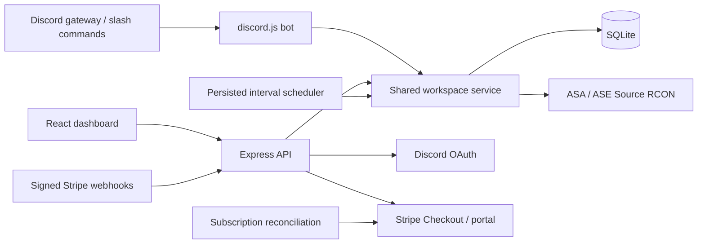

# Rookrift architecture

`server/index.js` owns process lifecycle, gateway startup, monitoring, the scheduler, and periodic billing reconciliation. `server/app.js` handles OAuth, sessions, CSRF, schemas, REST routes, and static production assets. `server/service.js` is shared by browser actions, bot commands, and scheduled tasks, so limits cannot be bypassed by switching interfaces.

Each Discord identity owns one workspace. Every server, schedule, activity record, and Stripe subscription belongs to that workspace. A guild may be linked to one workspace only. Dashboard access is owner-only. Discord community members with Manage Server can execute commands against the linked workspace, so linking a guild intentionally grants those admins operational control.

There is no client-selected workspace ID on mutations. The session resolves the owner workspace server-side. Server deletion and controls resolve the target within that workspace. Paid access is derived from current subscription status and known configured prices. Unknown prices and non-active payment statuses resolve to the free plan.

RCON and Discord access tokens are encrypted with AES-256-GCM and random IVs. Browser sessions use random 256-bit opaque tokens whose hashes are stored in SQLite. Production cookies use Secure, HttpOnly, and SameSite=Lax. OAuth state is hashed, short-lived, bound to a browser cookie, and consumed once. Mutating authenticated requests require an exact Origin and CSRF header. No encryption key is shipped to the browser.

Public target validation rejects loopback, link-local, private, multicast, and reserved IP ranges unless an operator opts into private connectivity. DNS results are validated and pinned. In production, enforce network egress rules in addition to application validation. A compromised host must not have unrestricted access to internal infrastructure.

The DayZ adapter declares its different BattlEye protocol and remains unavailable. Adding a game requires a transport implementation, command mapping, parser tests, connection tests, and UI capability updates. Never route DayZ through the ARK Source RCON adapter.

The hosted Site packages `dist/` from `npm run build:demo`. It intentionally uses browser storage and simulated actions. The Docker deployment runs a live-mode build, real OAuth, the persistent backend, Discord gateway, Stripe endpoints, and TCP RCON. They are separate deployment targets.

Scaling boundaries: one process, one SQLite store, sequential poll cycles, local command locks. Use PostgreSQL plus a queue and distributed job claims before multiple replicas. A production operation also needs monitoring, external uptime checks, restore drills, incident response, account deletion/export handling, and dependency maintenance.
